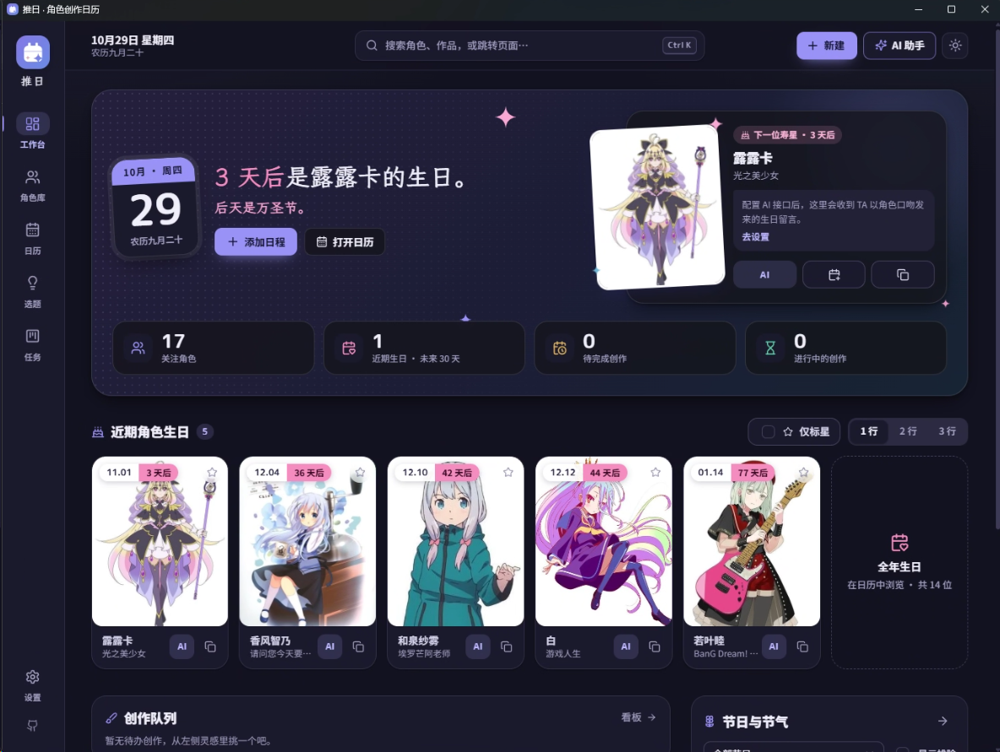

# 推日 · 角色创作日历



把喜欢的角色、生日和创作计划整理在一起。推日是一款本地优先的日历与创作规划应用，也可安装为 PWA。

## 功能

- 管理角色资料、生日、头像与 Tag，浏览近期寿星。
- 查看公历、农历节日和节气，导出 ICS 日历。
- 规划创作任务与年度选题，并用 JSON 备份和迁移数据。
- 可选配置 AI，生成寿星留言、推荐内容或与角色聊天。
- 支持离线使用；角色和设置默认保存在当前设备。

## 使用

- **浏览器 / PWA**：安装 Node.js 22.12 或更新版本后，运行 `start.cmd`，再从浏览器菜单安装为应用。
- **Windows 桌面版**：在 [GitHub Releases](https://github.com/befoer/oshi-calendar/releases) 下载安装版，支持软件内下载更新、重启安装。另提供文件夹版和单文件便携版。桌面版无需安装 Node.js。
- **本地运行**：安装 Node.js 22.12 或更新版本，在项目目录运行：

```sh
npm install
npm run dev
```

需要 AI 功能时，在「设置 → AI 接口」填写兼容 OpenAI 格式的接口地址、模型和密钥。AI 是可选功能。

## 数据与隐私

应用不要求账号，也不提供云同步。角色资料、日程和头像保存在浏览器本机；可通过「设置 → 数据与备份」导出或导入 JSON。密钥默认保存在本机浏览器，不包含在备份中。搜索角色或使用 AI 时，相关请求会发送到所选服务。

## 开发

```sh
npm install
npm run dev
npm test
npm run build
```

Windows 桌面包可用 `npm run electron:build` 构建，产物位于 `release/`。

角色资料来源可在应用内查看。Bangumi 与 AniList 提供公开资料；AI 请求发送至用户自行配置的服务。
